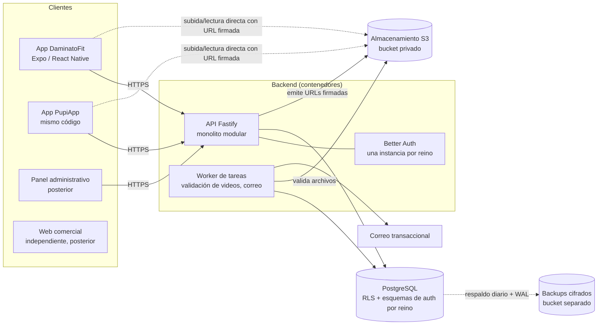
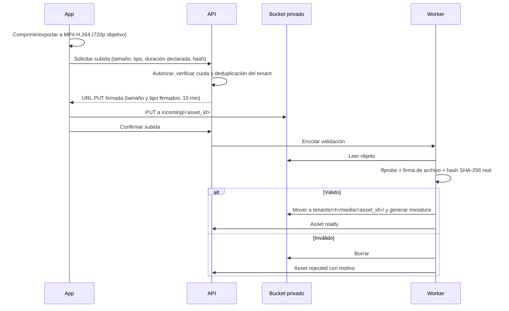
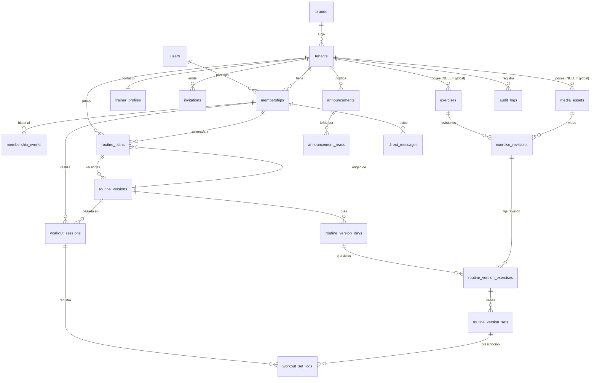

# Arquitectura DaminatoFit / PupiApp

> **Versión:** revisión 2 (21/11/2026). Reemplaza la versión aprobada el mismo día; los cambios están resumidos en la sección 10.
> **Estado del código:** Fases **0**, **0.1**, **1**, **2** y **2.1** (cierre: reset, borrado de cuenta) implementadas localmente. Fase 3 pendiente de aprobación.
> **Convención del documento:** cada afirmación sobre terceros (precios, políticas de tiendas, librerías) indica si fue **verificada** en la fuente el 21/11/2026 o si es una **estimación**. Las reglas comerciales se marcan como **definidas** o **pendientes**.

---

## 0. Resumen ejecutivo

- **Producto.** DaminatoFit es la plataforma comercial general para entrenadores y alumnos, con un futuro módulo de acuerdos comerciales con proveedores y profesionales. PupiApp es la app exclusiva de una preparadora física e influencer, construida con la misma base de código, y será la primera implementación real.
- **Arquitectura.** Se mantiene: monorepo, app Expo/React Native, API Node.js modular (Fastify), PostgreSQL multi-tenant con Row Level Security, videos en almacenamiento compatible con S3, todo en contenedores y configurable por entorno.
- **Cambios principales de esta revisión:**
  1. **Autenticación:** se reemplaza la implementación propia por **Better Auth** (biblioteca open source, sin costo), con una instancia por "reino de identidad" para conservar cuentas independientes entre DaminatoFit y PupiApp.
  2. **Aislamiento de datos:** políticas RLS completas (datos globales, alumnos con varios entrenadores, archivos privados, administración) y una matriz de pruebas de aislamiento automatizada.
  3. **Rutinas versionadas:** versiones inmutables de rutinas y revisiones de ejercicios, con plantillas reutilizables y personalización por alumno sin perder historial.
  4. **Marcas:** se distinguen tres conceptos (marca, distribución y reino de identidad). Las futuras marcas personalizadas pueden vivir **dentro** de la app DaminatoFit, sin publicación propia.
  5. **Infraestructura:** comparación de tres opciones; compartir el VPS de AppMédica queda **no recomendado** por la presencia de datos clínicos.
  6. **Videos:** validación real del archivo en el servidor, cuotas por entrenador y no por alumno, deduplicación segura.
  7. **Modelo comercial:** fórmulas de precio y referidos documentadas con lo definido; lo no definido queda como decisión pendiente.
  8. **Seguridad progresiva:** controles en cada fase, backups con restauración probada, observabilidad y recuperación.
- **Recomendación:** la arquitectura queda preparada para continuar. La Fase 0 ya existe y necesita solo un ajuste menor (Fase 0.1, sección 8). La Fase 1 puede comenzar sin decisiones del propietario; las decisiones pendientes (sección 9) bloquean fases posteriores, no el inicio.

---

## 1. Contexto, alcance y restricciones

### 1.1 Decisiones del propietario (definidas)

| #   | Decisión                                                                                                                                                                  |
| --- | ------------------------------------------------------------------------------------------------------------------------------------------------------------------------- |
| 1   | Android e iOS como plataformas principales; web comercial independiente.                                                                                                  |
| 2   | DaminatoFit y PupiApp comparten una base de código, con marcas diferentes.                                                                                                |
| 3   | Cada entrenador gestiona alumnos, rutinas, ejercicios, videos y progreso.                                                                                                 |
| 4   | Biblioteca general de ejercicios + videos propios; el alumno nunca está obligado a reproducirlos.                                                                         |
| 5   | Mensajes generales e individuales del entrenador hacia alumnos; sin chat ni respuestas.                                                                                   |
| 6   | WhatsApp del entrenador como enlace en la sección Contacto.                                                                                                               |
| 7   | DaminatoFit: USD 2 por alumno activo al mes, con tope de USD 20.                                                                                                          |
| 8   | Referidos: cada nuevo entrenador referido válido en el mes otorga 1/3 de descuento en la cuota de ese mes; 3 referidos = 100 %; no hay descuentos permanentes acumulados. |
| 9   | Cada entrenador puede incorporar sus propios acuerdos comerciales con proveedores.                                                                                        |
| 10  | Directorio de proveedores con suscripción anual para buscar alianzas con entrenadores.                                                                                    |
| 11  | Rubros de acuerdos: indumentaria, equipamiento, viandas saludables, eventos y servicios complementarios.                                                                  |
| 12  | Acuerdos con profesionales sanitarios: respetar la normativa ética y legal; **no** se presuponen comisiones por derivación de pacientes.                                  |
| 13  | Minimizar costos iniciales sin comprometer calidad, migración ni escalado.                                                                                                |
| 14  | AppMédica es independiente (VPS Hostinger KVM 1: 1 vCPU, 4 GB RAM, 50 GB disco, Ubuntu 24.04). No se comparten datos, credenciales ni bases de datos.                     |
| 15  | No se modifica ni se accede al VPS durante esta revisión.                                                                                                                 |

Decisiones previas que se mantienen: repositorio en `C:\dev\daminatofit` con GitHub y GitHub Actions; PupiApp con un único tenant y sin registro abierto de entrenadores; **solo la biblioteca global se comparte entre marcas**; cuentas independientes por marca; un alumno puede tener más de un entrenador (poco frecuente); un tenant tiene un solo entrenador en la primera etapa, con gimnasios como sección futura.

### 1.2 Fuera del alcance de la primera etapa

Facturación, referidos, directorio de proveedores, acuerdos comerciales y atribución de ventas **no se desarrollan todavía**. El modelo de datos se diseña para incorporarlos sin rediseño (sección 4).

---

## 2. Arquitectura revisada

### 2.1 Vista general



- **Monolito modular**: una API desplegable, módulos con límites claros. El **worker** es el mismo código e imagen con otro comando de inicio; procesa tareas en segundo plano usando una cola sobre PostgreSQL (`pg-boss` o `graphile-worker`), sin agregar Redis.
- **Portabilidad**: contenedores + variables de entorno + protocolos estándar (PostgreSQL, S3, SMTP). Cambiar de proveedor implica cambiar configuración, no código.

### 2.2 Tecnologías

| Capa                      | Elección                                                                 | Motivo                                                                                            |
| ------------------------- | ------------------------------------------------------------------------ | ------------------------------------------------------------------------------------------------- |
| Móvil                     | Expo SDK 58 + React Native + TypeScript, Expo Router                     | Una base para Android e iOS, variantes por marca con `app.config.ts`, compilación local gratuita. |
| Estado de servidor        | TanStack Query                                                           | Caché, reintentos y estados de carga estándar.                                                    |
| Formularios               | React Hook Form + Zod                                                    | Validación compartida con la API.                                                                 |
| Offline                   | expo-sqlite + cola de envíos (outbox)                                    | Registro de entrenamiento sin señal.                                                              |
| Backend                   | Node.js 22 LTS + Fastify                                                 | Liviano y rápido, con validación por esquema.                                                     |
| Datos                     | PostgreSQL 17 + Drizzle ORM + migraciones SQL versionadas                | Relacional, RLS nativo, transacciones con contexto por request.                                   |
| Autenticación             | **Better Auth** (MIT) + plugin Expo, adaptador Drizzle                   | Ver 2.3.                                                                                          |
| Tareas en segundo plano   | Cola sobre PostgreSQL (`pg-boss` o `graphile-worker`)                    | Sin infraestructura adicional; reintentos y tareas programadas.                                   |
| Videos                    | S3 compatible: RustFS en local; Cloudflare R2 (preferido) o Backblaze B2 | Sin egreso en R2 (verificado), migrable entre proveedores S3.                                     |
| Inspección de video       | `ffprobe` en el worker                                                   | Validación real del contenedor, códec y duración.                                                 |
| Pruebas                   | Vitest, jest-expo + Testing Library, Maestro (E2E), k6 (carga)           | Todas open source.                                                                                |
| Web comercial (posterior) | Sitio estático (p. ej. Astro) en hosting estático gratuito               | Independiente de la API; sin datos de usuarios.                                                   |

### 2.3 Autenticación (reevaluación)

**Requisitos:** cuentas independientes entre DaminatoFit y PupiApp, apps nativas Expo, PostgreSQL propio, sin costo por usuario, recuperación de contraseña, verificación de correo, eliminación de cuenta, límites de intentos y revocación de sesiones.

| Opción                             | Seguridad                                                                                                                                        | Mantenimiento                                      | Expo                                                   | PostgreSQL                                              | Costo                    | Encaje                                           |
| ---------------------------------- | ------------------------------------------------------------------------------------------------------------------------------------------------ | -------------------------------------------------- | ------------------------------------------------------ | ------------------------------------------------------- | ------------------------ | ------------------------------------------------ |
| Propia (JWT + refresh rotativo)    | Depende solo de nuestro código; sin auditoría externa. Los errores típicos (carreras en refresh, enumeración, tokens) son difíciles de detectar. | Alto y permanente                                  | Total (a medida)                                       | Total                                                   | Gratis                   | Bueno, pero con el mayor riesgo                  |
| **Better Auth**                    | Flujos maduros; divulgación pública de vulnerabilidades con parches (verificado: avisos frecuentes en 2026, la mayoría en plugins opcionales).   | Bajo: actualizar versiones                         | Integración oficial (`@better-auth/expo`, SecureStore) | Drizzle/PostgreSQL oficial, esquemas no predeterminados | Gratis (MIT)             | Muy bueno con un reino por instancia (ver abajo) |
| Supabase Auth (GoTrue autoalojado) | Madura                                                                                                                                           | Servicio adicional que operar                      | Buena                                                  | Acopla esquema propio                                   | Gratis autoalojado       | Agrega un servicio y su modelo de datos          |
| Ory Kratos / Keycloak / Zitadel    | Muy madura                                                                                                                                       | Servicio adicional; Keycloak consume mucha memoria | Flujos nativos posibles, más trabajo                   | Sí                                                      | Gratis autoalojado       | Excesivo para el tamaño actual                   |
| Clerk / Auth0                      | Muy madura                                                                                                                                       | Mínimo                                             | Buena                                                  | Usuarios fuera de nuestra base                          | Costo por usuario activo | Contradice "minimizar costos" y dificulta migrar |

**Recomendación: Better Auth, con estas condiciones.**

1. **Un reino de identidad por app independiente.** Cada reino (`daminatofit`, `pupiapp`) es una instancia de Better Auth con sus tablas en **su propio esquema de PostgreSQL** (`auth_daminatofit`, `auth_pupiapp`). Verificado: Better Auth admite esquemas no predeterminados y nombres de tabla configurables. Así el correo es único dentro de cada reino y las cuentas no se mezclan, sin código de autenticación propio.
2. **Plugins mínimos:** `emailAndPassword` y `expo`. Más adelante, `twoFactor` para entrenadores y administración. **No** se usan los plugins SSO, SCIM, OAuth provider, Stripe, API keys ni magic link, que concentran la mayoría de los avisos de seguridad publicados.
3. **Sin caché de sesión en cookie ni almacenamiento secundario al inicio.** Hay un aviso de 2026 sobre sesiones revocadas que seguían válidas en esa configuración. Se valida la sesión contra la base en cada request; la carga es aceptable a esta escala.
4. **Versiones fijadas y vigilancia de avisos:** Dependabot y alertas de seguridad de GitHub. Un aviso alto o crítico se atiende en un máximo de 72 horas (objetivo propuesto).
5. **Capa propia de autorización.** Better Auth solo responde "quién es"; tenants, membresías, roles y RLS siguen siendo nuestros. No se usa su plugin de organizaciones, porque se superpone con nuestro modelo y con RLS.
6. **Aislado en `modules/auth`:** si en el futuro hubiera que reemplazarlo, el cambio queda acotado a ese módulo.

**Flujo móvil:** la app usa el cliente oficial con `expo-secure-store`; la API monta cada instancia en `/auth/<reino>/*` y, en las rutas de dominio, valida la sesión del reino que corresponde a la app (encabezado `x-app-brand`). Una sesión de un reino no existe en el esquema del otro, así que usar un token de PupiApp en DaminatoFit falla por diseño. Login de terceros (Google, Apple) queda fuera del alcance inicial; si se agrega, Apple 4.8 exige ofrecer una opción equivalente que proteja la privacidad (verificado).

**Riesgo residual:** dependencia de un proyecto activo pero joven con un ritmo alto de avisos. Mitigación: plugins mínimos, actualizaciones rápidas, pruebas de seguridad propias en CI (sección 6) y la capa de autorización independiente.

### 2.4 Aislamiento de datos

#### Capas de defensa

1. **Autorización en la API** (capa principal): políticas centralizadas por recurso y acción.
2. **RLS en PostgreSQL** (red de seguridad): aunque la API tenga un error, la base no devuelve filas ajenas.
3. **Almacenamiento privado**: bucket sin acceso público; solo URLs firmadas de corta duración, emitidas después de autorizar.
4. **Pruebas automáticas** que demuestran el aislamiento en cada cambio.

#### Roles de base de datos

| Rol            | Uso                                         | Permisos                                                                                          |
| -------------- | ------------------------------------------- | ------------------------------------------------------------------------------------------------- |
| `app_migrator` | Solo migraciones (CI y despliegue)          | Dueño del esquema; DDL. Nunca lo usa la API.                                                      |
| `app_user`     | API en ejecución                            | `NOBYPASSRLS`, sin DDL, sin ser dueño de tablas. Todas las tablas con `FORCE ROW LEVEL SECURITY`. |
| `app_worker`   | Tareas en segundo plano                     | Igual que `app_user`, más acceso acotado a tablas de tareas y a columnas de validación de medios. |
| `app_admin`    | Operaciones de administración de plataforma | Políticas específicas de administración (no `BYPASSRLS`); cada acceso queda auditado.             |
| `app_backup`   | Respaldos                                   | Solo lectura para `pg_dump` / archivado WAL.                                                      |
| `auth_<reino>` | Instancias de Better Auth                   | Acceso solo a su esquema `auth_<reino>`.                                                          |

#### Contexto por request

En cada transacción la API fija variables locales con `set_config(..., true)`: `app.realm`, `app.user_id`, `app.tenant_id`, `app.membership_id` y `app.role`. Las funciones auxiliares (`app.current_tenant_id()`, etc.) devuelven `NULL` si falta el valor, y **toda política falla cerrada**: sin contexto no hay filas. Como las variables son locales a la transacción, el esquema funciona con pools de conexiones en modo transacción.

**Tenant activo:** el cliente indica el tenant con `x-tenant-id`. La API lo acepta solo si el usuario tiene una membresía **activa** en ese tenant y **del mismo reino**; recién entonces fija el contexto. Nunca se usa un `tenant_id` del cuerpo de la request.

#### Políticas por tipo de dato

| Tipo de dato                                                                                  | Lectura                                                                                                                        | Escritura                                                                  |
| --------------------------------------------------------------------------------------------- | ------------------------------------------------------------------------------------------------------------------------------ | -------------------------------------------------------------------------- |
| **Global** (ejercicios y medios de biblioteca, grupos musculares)                             | Cualquier contexto autenticado, de cualquier reino                                                                             | Solo `app_admin`                                                           |
| **Del tenant** (ejercicios propios, plantillas de rutina, avisos, perfil)                     | Miembros activos del tenant (los avisos, solo alumnos activos y el entrenador)                                                 | Solo el entrenador (`owner`) del tenant                                    |
| **Privado del alumno** (rutinas asignadas, sesiones, series, progreso, mensajes individuales) | El entrenador del tenant **o** el alumno titular (`student_membership_id = app.membership_id`)                                 | Rutinas y mensajes: entrenador. Registros de entrenamiento: alumno titular |
| **Usuarios**                                                                                  | El propio usuario; el entrenador ve un perfil reducido (nombre, foto) de sus alumnos mediante una vista con columnas limitadas | El propio usuario                                                          |
| **Archivos** (`media_assets`)                                                                 | Ámbito global o tenant del contexto; la URL firmada se emite solo después de esa lectura                                       | Entrenador del tenant; validación por `app_worker`                         |
| **Auditoría**                                                                                 | `app_admin`; el entrenador, solo eventos de su tenant                                                                          | Solo inserción (sin `UPDATE` ni `DELETE` para ningún rol de la app)        |

**Alumno con varios entrenadores:** tiene una membresía por tenant. Cada request opera sobre **un solo tenant**. Lo que registra con el entrenador A pertenece al tenant A: el entrenador B no lo ve. Una vista unificada para el alumno ("todos mis entrenadores") se arma con consultas separadas por membresía, nunca con una consulta cruzada.

**Separación entre marcas:** un disparador impide crear una membresía si el reino del usuario no coincide con el reino de la marca del tenant. La política sobre `tenants` exige `realm = app.realm`.

**Archivos privados:** claves de objeto con el formato `tenants/<tenant_id>/media/<asset_id>/original.mp4` y `global/media/<asset_id>/...`. El bucket es privado y la credencial de la API está limitada a ese bucket. Las URLs de lectura duran 10 minutos (valor propuesto, configurable) y se emiten solo para assets `ready` visibles en el contexto actual.

**Administración:** la API de administración es una superficie separada (prefijo y autenticación con segundo factor obligatorio). Por defecto la administración ve **metadatos** (tenants, cantidad de alumnos, uso), no el contenido de entrenamientos ni de mensajes. Para leer contenido se usa un acceso de soporte excepcional con motivo obligatorio, temporal y auditado.

#### Diseño de pruebas de aislamiento

**Escenario base (fixtures):**

- Reino DaminatoFit: tenant **T1** (entrenador A; alumnos S1 y S2) y tenant **T2** (entrenador B; alumno S3; **S2 también es alumno de T2**).
- Reino PupiApp: tenant **TP** (entrenadora P; alumno SP).
- Datos globales: ejercicio G y su video.

**Niveles de prueba:**

| Nivel                               | Qué verifica                                                                                                                                                                                                                                                        |
| ----------------------------------- | ------------------------------------------------------------------------------------------------------------------------------------------------------------------------------------------------------------------------------------------------------------------- |
| 1. Catálogo de la base              | Toda tabla con `tenant_id` tiene RLS habilitado y forzado; las tablas sin `tenant_id` están en una lista explícita de tablas globales; `app_user` no tiene `BYPASSRLS`; toda función `SECURITY DEFINER` fija `search_path`. Una tabla nueva sin políticas rompe CI. |
| 2. RLS directo (SQL)                | Conectado como `app_user`, para cada actor y tabla: `SELECT`, `INSERT`, `UPDATE` y `DELETE` sobre filas ajenas devuelven 0 filas o error. Sin contexto: 0 filas en todas las tablas.                                                                                |
| 3. Matriz de autorización de la API | Una tabla declarativa (`recurso × acción × rol permitido`) genera pruebas para cada actor. Un endpoint nuevo que no figure en la matriz hace fallar la suite.                                                                                                       |
| 4. IDOR                             | Cada endpoint con ID en la ruta se invoca con IDs de otro tenant y de otro alumno: siempre 404 (no 403, para no revelar existencia).                                                                                                                                |
| 5. Archivos                         | Pedir una URL firmada de un asset ajeno es denegado; una clave adivinada sin firma es rechazada por el bucket; una URL vencida falla.                                                                                                                               |
| 6. Marcas y reinos                  | Una sesión de PupiApp no sirve en DaminatoFit ni a la inversa; no se puede crear una membresía entre reinos; PupiApp rechaza crear un segundo tenant.                                                                                                               |

**Casos obligatorios (ejemplos):**

- S1 no puede leer rutinas, sesiones, progreso ni mensajes de S2 (mismo tenant).
- El entrenador A no puede leer nada de T2, aunque S2 pertenezca a ambos.
- El entrenador B ve lo que S2 registra en T2 y **no** lo que registra en T1.
- S1 no puede crear, editar ni borrar rutinas ni enviar mensajes.
- Todos leen el ejercicio global G; nadie salvo `app_admin` puede modificarlo.
- SP no ve ejercicios propios, alumnos ni avisos de DaminatoFit, y viceversa.

### 2.5 Marcas, distribución y personalización

#### Tres conceptos separados

| Concepto               | Qué es                                                                                                           | Ejemplo                                |
| ---------------------- | ---------------------------------------------------------------------------------------------------------------- | -------------------------------------- |
| **Marca**              | Identidad visual y textos (nombre, logo, colores, enlaces legales).                                              | DaminatoFit, PupiApp                   |
| **Distribución**       | Cómo llega al usuario: `platform` (dentro de la app DaminatoFit) o `standalone` (binario propio en las tiendas). | PupiApp es `standalone`.               |
| **Reino de identidad** | Conjunto de apps que comparten cuentas de usuario.                                                               | Reino `daminatofit` y reino `pupiapp`. |

**No toda futura marca personalizada necesita una app propia.** Se prevén dos niveles:

1. **Personalización dentro de DaminatoFit** (opción por defecto para futuros entrenadores): logo, colores y nombre del espacio del entrenador se muestran dentro de la app DaminatoFit. No requiere publicación ni cuenta de desarrollador, y coincide con el modelo "agregado" que Apple 4.2.6 menciona como aceptable (verificado). Requiere solo configuración por tenant (`tenants.branding`), sin nuevo binario.
2. **App independiente** (como PupiApp): binario propio, reino propio, publicación desde la cuenta de desarrollador del titular del contenido. Se reserva para casos con justificación comercial.

**Reglas por marca (configuración, no código duplicado):**

| Regla                      | DaminatoFit               | PupiApp                                          |
| -------------------------- | ------------------------- | ------------------------------------------------ |
| Distribución               | `platform`                | `standalone`                                     |
| Reino de identidad         | `daminatofit`             | `pupiapp`                                        |
| Registro de entrenadores   | Abierto                   | Cerrado (`max_tenants = 1`, validado en la base) |
| Alta de alumnos            | Invitación del entrenador | Invitación de la entrenadora                     |
| Biblioteca global          | Compartida                | Compartida                                       |
| Personalización por tenant | Permitida (posterior)     | No aplica (la marca es la del tenant)            |

En la app, la marca se embebe al compilar (`APP_BRAND`); el JavaScript no contiene datos de otras marcas (ya verificado en la Fase 0). En la API, la marca de la app se valida contra el reino de la sesión y la marca del tenant.

#### Publicación en tiendas: qué verificar antes de publicar

**Apple App Store** (texto vigente verificado el 21/11/2026):

| Directriz                                   | Implicancia                                                                                                                | Acción                                                                                                                                |
| ------------------------------------------- | -------------------------------------------------------------------------------------------------------------------------- | ------------------------------------------------------------------------------------------------------------------------------------- |
| 4.2.6 Apps de plantilla                     | Se rechazan salvo que las publique **directamente el proveedor del contenido**, o que exista un único binario "agregador". | PupiApp se publica desde la **cuenta de desarrollador de la preparadora** (o de su empresa). Las demás marcas, dentro de DaminatoFit. |
| 4.3 Spam                                    | No crear múltiples Bundle IDs de la misma app; no publicar variantes indistinguibles.                                      | PupiApp debe tener identidad y contenido propios; no publicar más variantes sin justificación.                                        |
| 3.1.1 Compras integradas                    | Desbloquear funciones o suscripciones dentro de la app exige compra integrada de Apple.                                    | Ver riesgo de cobro a entrenadores (sección 4.3).                                                                                     |
| 3.1.3(f) Apps acompañantes gratuitas        | La excepción solo cubre VoIP, almacenamiento en la nube, correo y hosting.                                                 | **No** asumir que DaminatoFit queda cubierta.                                                                                         |
| 3.1.3(e) Bienes y servicios fuera de la app | Bienes físicos y servicios consumidos fuera de la app **deben** usar otros medios de pago.                                 | Los acuerdos (indumentaria, viandas, eventos) no usan compra integrada.                                                               |
| 5.1.1(v) Cuentas                            | Si se pueden crear cuentas, la eliminación de cuenta debe estar dentro de la app.                                          | Ya previsto (Fase 2).                                                                                                                 |
| 4.8 Servicios de login                      | Con login social, se debe ofrecer una opción equivalente que proteja la privacidad.                                        | Solo aplica si se agrega login social.                                                                                                |

**Google Play** (verificado el 21/11/2026):

| Política                                                        | Implicancia                                                                                                                                                               | Acción                                                                                                              |
| --------------------------------------------------------------- | ------------------------------------------------------------------------------------------------------------------------------------------------------------------------- | ------------------------------------------------------------------------------------------------------------------- |
| Pagos                                                           | Las compras de funciones, suscripciones o software de productividad dentro de la app deben usar Google Play Billing; los bienes y servicios físicos **no** pueden usarla. | Misma decisión de cobro que en Apple; acuerdos comerciales fuera de Play Billing.                                   |
| Cuentas personales nuevas (desde 13/11/2023)                    | Antes de publicar: prueba cerrada con al menos 12 testers durante 14 días consecutivos.                                                                                   | Planificar la beta de PupiApp con esos testers, o publicar desde una cuenta de organización (verificar requisitos). |
| Spam y contenido repetitivo; Data Safety; eliminación de cuenta | A verificar al preparar la ficha (no revisado en detalle en esta revisión).                                                                                               | Checklist de publicación en la Fase 7.                                                                              |

**Otros puntos a verificar antes de publicar PupiApp:** derechos documentados sobre el nombre, la imagen y los contenidos de la preparadora (Apple 5.2, propiedad intelectual); política de privacidad y términos por marca; credenciales de prueba para revisores; etiquetas de privacidad (Apple) y formulario Data Safety (Google); quién es el responsable del tratamiento de datos de los alumnos de PupiApp.

### 2.6 Videos

#### Flujo de subida segura



- **Validación real en el servidor:** no se confía en la extensión, el tipo MIME ni la duración que declara el cliente. El worker verifica la firma del contenedor (MP4/MOV), el códec (H.264 video, AAC o sin audio), la resolución, la duración y el tamaño real, y calcula el SHA-256. Si el archivo no se puede analizar, se rechaza.
- **Formatos:** se acepta MP4 o MOV con H.264. HEVC se rechaza al inicio porque algunos Android de gama baja no lo reproducen; la app exporta a H.264 antes de subir cuando el sistema lo permite. Sin transcodificación en el servidor en la primera etapa (consume mucha CPU).
- **Tamaño en la subida:** las URLs PUT firmadas incluyen `Content-Length` y `Content-Type` dentro de la firma, así el bucket rechaza un archivo distinto del declarado. Hay que verificar este comportamiento con el proveedor elegido antes de producción; R2 no admite subidas POST con política (a verificar).
- **Zona de cuarentena:** todo entra en `incoming/`. Una regla de ciclo de vida borra los objetos de `incoming/` con más de 24 horas. Solo los archivos validados pasan a la ruta definitiva.
- **Deduplicación:** se usa el hash **calculado por el servidor**. Se deduplica **solo dentro del mismo ámbito** (mismo tenant o biblioteca global). Deduplicar entre tenants permitiría deducir qué archivos tiene otro entrenador.
- **Referencias y borrado:** un ejercicio referencia el asset, no lo copia. Un asset sin referencias pasa a `orphaned` y se borra a los 30 días (valor propuesto). Los assets referenciados por versiones publicadas de rutinas no se borran mientras esas versiones existan.
- **Reproducción protegida:** URLs de lectura firmadas de 10 minutos, emitidas tras autorizar. Esto evita el acceso público y el enlazado permanente, pero **no** impide que un usuario autorizado grabe la pantalla. No se propone DRM, por costo y complejidad.
- **Experiencia:** el video nunca se reproduce solo. El alumno ve una miniatura y toca para reproducir. Hay una opción de "solo con Wi-Fi" y en la primera etapa no se guardan videos sin conexión.

#### Límites y rentabilidad

Costo de referencia en Cloudflare R2 (verificado el 21/11/2026): USD 0,015 por GB-mes, 10 GB gratis por mes, **egreso gratuito**, USD 0,36 por millón de lecturas (Clase B).

| Límite (valores iniciales propuestos, configurables) | Valor                         | Justificación                                                                                |
| ---------------------------------------------------- | ----------------------------- | -------------------------------------------------------------------------------------------- |
| Duración máxima por video                            | 90 s                          | Videos demostrativos; mantiene archivos chicos.                                              |
| Tamaño máximo por archivo                            | 100 MB                        | Margen para 1080p; con 720p a ~3 Mbps, 90 s ≈ 35 MB (estimación).                            |
| Resolución máxima                                    | 1080p                         | Calidad suficiente en un teléfono.                                                           |
| **Almacenamiento por entrenador**                    | **5 GB**                      | Aproximadamente 150 a 250 videos. Costo máximo estimado: USD 0,075/mes por entrenador en R2. |
| Subidas por día y entrenador                         | 30                            | Evita abusos y picos del worker.                                                             |
| URLs de lectura por usuario                          | Límite por minuto (p. ej. 60) | Evita extracción masiva.                                                                     |

**Por qué la cuota es por entrenador y no por alumno:** el costo de un video depende de cuántos se **almacenan**, no de cuántos alumnos los miran (el egreso es gratuito en R2 y cada lectura cuesta centavos por millón). Un entrenador con muchos alumnos no genera más costo de almacenamiento, así que no se lo penaliza. Incluso con el tope de USD 20, el costo de video por entrenador es una fracción mínima del ingreso (estimación con precios verificados). Las cuotas sirven para **evitar abusos**; ampliarlas o venderlas es una decisión comercial pendiente.

Al llegar a la cuota, se bloquean las subidas nuevas, nunca la reproducción, y la app sugiere qué videos no se usan en ninguna rutina.

### 2.7 Experiencia de usuario y funcionamiento sin conexión

**Alumno (prioridad: entrenar sin fricción):**

- Pantalla **"Hoy"**: la rutina del día y un botón grande para empezar.
- Modo sesión: ejercicio y serie actuales, peso y repeticiones precargados (lo prescrito o el último valor), botones +/− grandes, un toque para completar la serie, temporizador de descanso automático con vibración, pantalla siempre encendida.
- Sin conexión: la versión de rutina asignada se guarda en SQLite; cada serie se guarda localmente con un `client_id` (UUID) y se envía con una cola idempotente. Un indicador discreto muestra el estado de sincronización.
- Secciones **Avisos** y **Mensajes**: bandejas de solo lectura, sin campo de respuesta. **Contacto**: enlace `wa.me` al WhatsApp del entrenador, visible solo para sus alumnos.
- Videos opcionales: miniatura y reproducción solo al tocar.

**Entrenador (prioridad: armar y asignar rápido):**

- Plantillas de rutina reutilizables, duplicar, asignar a uno o varios alumnos y personalizar por alumno sin afectar al resto (ver 3.3).
- Buscador de la biblioteca con filtros; crear un ejercicio propio en pocos pasos.
- Vista por alumno: rutina vigente, cumplimiento, progreso y el historial de versiones.
- Avisos generales y mensajes individuales; nunca un hilo de conversación.

**Criterios comunes:** objetivos táctiles de 48×48 dp o más, uso con una mano, modo claro y oscuro, contraste WCAG AA (ya verificado por prueba automática en la Fase 0), lectores de pantalla, listas virtualizadas, tiempo de inicio corto y sin animaciones bloqueantes.

**Conflictos offline:** los registros de entrenamiento son de solo agregado. Si un alumno edita una serie ya enviada, gana la última escritura por serie y la versión anterior queda auditada. La sesión queda fijada a la **versión** de rutina con la que empezó, aunque el entrenador publique otra mientras el alumno está sin conexión.

### 2.8 Estructura de carpetas

Se mantiene la estructura de la Fase 0, con estos agregados:

```
apps/api/src/
├── server.ts              # API HTTP
├── worker.ts              # Tareas en segundo plano (misma imagen, otro comando)
├── auth/realms.ts         # Instancias de Better Auth por reino
├── db/
│   ├── schema/            # Dominio (public) + auth_<reino>
│   ├── migrations/        # SQL versionado, incluye roles y políticas RLS
│   └── tenant-tx.ts       # Transacción con contexto (realm, user, tenant, membership, role)
├── shared/authz/          # Políticas y matriz de autorización declarativa
└── modules/               # auth, accounts, tenants, memberships, trainer-profiles,
                           # media, exercises, routines, workouts, progress,
                           # announcements, messages, audit
apps/api/test/
├── fixtures/              # Escenario T1/T2/TP con S1, S2 (multi-tenant), S3, SP
├── isolation/             # Niveles 1–6 de pruebas de aislamiento
└── load/                  # Scripts k6
infra/
├── docker/compose.yml     # Desarrollo local (existente)
└── deploy/                # (posterior) compose de producción, Caddy, backups
```

`apps/admin` y `apps/web` siguen reservados para etapas posteriores.

---

## 3. Modelo de datos corregido

### 3.1 Convenciones

- Claves `uuid`; `created_at` y `updated_at` en todas las tablas; borrado lógico con `archived_at` donde importa el historial.
- `tenant_id` + RLS forzado en toda tabla de un tenant; `realm` en identidad y marcas.
- Pesos en kg `numeric(6,2)`; dinero en **centavos enteros** + código de moneda; duraciones en milisegundos.
- Contenido publicado (versiones de rutina, revisiones de ejercicio) es **inmutable**: un disparador impide modificarlo.

### 3.2 Diagrama



### 3.3 Tablas

**Identidad, marcas y tenants**

| Tabla               | Columnas principales                                                                                                                                                                                               | Notas                                                                                                              |
| ------------------- | ------------------------------------------------------------------------------------------------------------------------------------------------------------------------------------------------------------------ | ------------------------------------------------------------------------------------------------------------------ |
| `auth_<reino>.*`    | `user`, `session`, `account`, `verification` (gestionadas por Better Auth)                                                                                                                                         | Correo y credenciales viven **solo** acá. Un esquema por reino.                                                    |
| `brands`            | `id`, `slug`, `distribution` (`platform`/`standalone`), `realm`, `max_tenants` (NULL = sin límite), `status`                                                                                                       | PupiApp: `standalone`, `max_tenants = 1`.                                                                          |
| `users`             | `id`, `realm`, `auth_user_id`, `display_name`, `avatar_media_id`, `platform_role` (`user`/`platform_admin`), `status`, `deleted_at`                                                                                | Perfil de dominio. Único por (`realm`, `auth_user_id`). Sin correo ni contraseña.                                  |
| `tenants`           | `id`, `brand_id`, `kind` (`trainer`; reservados `gym`, `provider`), `name`, `owner_user_id`, `branding` (jsonb, personalización dentro de DaminatoFit), `storage_quota_bytes` (NULL = valor por defecto), `status` | `kind` habilita gimnasios y proveedores sin rediseño.                                                              |
| `memberships`       | `id`, `tenant_id`, `user_id`, `role` (`owner`/`student`; reservado `trainer` para gimnasios), `status` (`invited`/`active`/`paused`/`archived`), `activated_at`, `deactivated_at`                                  | Único por (`tenant_id`, `user_id`). Disparador: el reino del usuario debe coincidir con el de la marca del tenant. |
| `membership_events` | `id`, `tenant_id`, `membership_id`, `from_status`, `to_status`, `occurred_at`, `actor_user_id`                                                                                                                     | Historial inmutable; base para cualquier definición de "alumno activo".                                            |
| `invitations`       | `id`, `tenant_id`, `email`, `role`, `token_hash`, `expires_at`, `accepted_at`, `created_by`                                                                                                                        | El token se guarda como hash. Aceptar la invitación verifica el correo.                                            |
| `trainer_profiles`  | `tenant_id` (PK), `display_name`, `bio`, `whatsapp_e164`, `avatar_media_id`                                                                                                                                        | Sección Contacto. Visible solo para alumnos activos del tenant.                                                    |

**Ejercicios y medios**

| Tabla                                     | Columnas principales                                                                                                                                                                                                                                                                                                                      | Notas                                                                                                                |
| ----------------------------------------- | ----------------------------------------------------------------------------------------------------------------------------------------------------------------------------------------------------------------------------------------------------------------------------------------------------------------------------------------- | -------------------------------------------------------------------------------------------------------------------- |
| `media_assets`                            | `id`, `tenant_id` (NULL = global), `kind` (`video`/`image`), `storage_key`, `status` (`pending_upload`/`validating`/`ready`/`rejected`/`orphaned`/`deleted`), `declared_size_bytes`, `size_bytes`, `sha256` (del servidor), `container`, `video_codec`, `width`, `height`, `duration_ms`, `poster_key`, `rejection_reason`, `uploaded_by` | Único por (ámbito, `sha256`) entre los `ready`.                                                                      |
| `tenant_usage`                            | `tenant_id`, `storage_bytes`, `video_count`, `updated_at`                                                                                                                                                                                                                                                                                 | Mantenido por el worker; base de cuotas.                                                                             |
| `exercises`                               | `id`, `tenant_id` (NULL = global), `current_revision_id`, `based_on_exercise_id`, `created_by`, `archived_at`                                                                                                                                                                                                                             | Identidad estable del ejercicio.                                                                                     |
| `exercise_revisions`                      | `id`, `exercise_id`, `tenant_id`, `revision_number`, `name`, `description`, `instructions`, `video_media_id`, `created_by`, `created_at`                                                                                                                                                                                                  | **Inmutable.** Editar un ejercicio crea una revisión nueva; las rutinas publicadas conservan la revisión que tenían. |
| `muscle_groups`, `exercise_muscle_groups` | catálogo global y relación N:N                                                                                                                                                                                                                                                                                                            | Filtros de búsqueda.                                                                                                 |

**Rutinas versionadas**

| Tabla                       | Columnas principales                                                                                                                                                                          | Notas                                                                                                              |
| --------------------------- | --------------------------------------------------------------------------------------------------------------------------------------------------------------------------------------------- | ------------------------------------------------------------------------------------------------------------------ |
| `routine_plans`             | `id`, `tenant_id`, `kind` (`template`/`assigned`), `student_membership_id` (solo `assigned`), `name`, `status` (`active`/`archived`), `current_version_id`, `source_version_id`, `created_by` | Identidad lógica de la rutina. `source_version_id` indica de qué versión (de plantilla o de otro alumno) se copió. |
| `routine_versions`          | `id`, `tenant_id`, `plan_id`, `version_number`, `status` (`draft`/`published`/`superseded`), `change_note`, `published_at`, `published_by`, `starts_on`, `ends_on`                            | Un solo borrador por plan. Publicada = inmutable.                                                                  |
| `routine_version_days`      | `id`, `tenant_id`, `version_id`, `name`, `position`, `notes`                                                                                                                                  | Copia completa por versión.                                                                                        |
| `routine_version_exercises` | `id`, `tenant_id`, `day_id`, `exercise_id`, `exercise_revision_id`, `position`, `notes`, `rest_seconds`, `superset_group`                                                                     | Fija la **revisión** del ejercicio: instrucciones y video de ese momento.                                          |
| `routine_version_sets`      | `id`, `tenant_id`, `version_exercise_id`, `position`, `target_reps_min`, `target_reps_max`, `target_weight_kg`, `rest_seconds`                                                                | Prescripción por serie.                                                                                            |

**Cómo funciona el versionado:**

1. **Crear o editar** trabaja siempre sobre un borrador (copia de la versión publicada vigente).
2. **Publicar** vuelve inmutable el borrador, marca la versión anterior como `superseded` y actualiza `current_version_id`. El alumno ve siempre la versión publicada vigente.
3. **Reutilizar:** una plantilla (`kind = template`) tiene sus propias versiones. Asignarla a un alumno crea un plan `assigned` cuya versión 1 es una copia de la versión de la plantilla, con `source_version_id` apuntando a ella.
4. **Personalizar:** editar el plan de un alumno genera nuevas versiones **solo** de ese plan. La plantilla y los demás alumnos no cambian.
5. **Actualizar desde la plantilla:** es una acción explícita del entrenador, que muestra las diferencias y publica una nueva versión del plan del alumno. Nunca se propaga en forma automática, para no cambiarle la rutina a un alumno a mitad de un ciclo.
6. **Reconstrucción histórica:** cada sesión guarda `routine_version_id`, así se puede reconstruir exactamente qué días, ejercicios (con su revisión), series, pesos, repeticiones e instrucciones tenía el alumno en cada fecha.
7. **Borrado:** las versiones publicadas no se borran (solo se archiva el plan), salvo por eliminación de cuenta o por obligación legal, que anonimizan.

El costo de almacenamiento es bajo: son filas de texto, no archivos.

**Entrenamiento realizado**

| Tabla              | Columnas principales                                                                                                                                                                                                                                                         | Notas                                                                              |
| ------------------ | ---------------------------------------------------------------------------------------------------------------------------------------------------------------------------------------------------------------------------------------------------------------------------- | ---------------------------------------------------------------------------------- |
| `workout_sessions` | `id`, `tenant_id`, `student_membership_id`, `routine_version_id`, `routine_version_day_id`, `client_id` (único), `started_at`, `finished_at`, `status`, `notes`, `synced_at`                                                                                                 | Fijada a una versión.                                                              |
| `workout_set_logs` | `id`, `tenant_id`, `session_id`, `exercise_id`, `routine_version_set_id` (nullable), `client_id` (único), `position`, `prescribed_reps_min`, `prescribed_reps_max`, `prescribed_weight_kg`, `actual_reps`, `actual_weight_kg`, `completed`, `logged_at`, `client_updated_at` | La copia de lo prescrito se mantiene: sirve sin conexión y para consultas rápidas. |

**Comunicación y transversal**

| Tabla                      | Columnas principales                                                                                           | Notas                                                            |
| -------------------------- | -------------------------------------------------------------------------------------------------------------- | ---------------------------------------------------------------- |
| `announcements`            | `id`, `tenant_id`, `author_user_id`, `title`, `body`, `published_at`, `archived_at`                            | Aviso único por publicación. Borrador si `published_at` es nulo. |
| `announcement_reads`       | `announcement_id`, `membership_id`, `read_at`                                                                  | Primera lectura por membresía.                                   |
| `direct_messages`          | `id`, `tenant_id`, `sender_user_id`, `recipient_membership_id`, `body`, `created_at`, `read_at`, `archived_at` | Solo entrenador → alumno; el cuerpo no se edita.                 |
| `push_devices`             | cuenta, reino, plataforma, token, estado                                                                       | Token del dispositivo, no de un tenant.                          |
| `notification_preferences` | preferencias de push de la cuenta                                                                              | No sustituyen el permiso del sistema.                            |
| `notification_deliveries`  | cola idempotente por aviso o mensaje, usuario y dispositivo                                                    | Payload genérico. No es la fuente del texto.                     |
| `audit_logs`               | `id`, `tenant_id`, `actor_user_id`, `action`, `entity_type`, `entity_id`, `metadata`, `created_at`             | Solo inserción. Sin datos sensibles en `metadata`.               |

### 3.4 Puntos de extensión comercial (verificados contra el modelo)

| Módulo futuro                   | Se apoya en                                                                                    | ¿Requiere rediseño?                 |
| ------------------------------- | ---------------------------------------------------------------------------------------------- | ----------------------------------- |
| Facturación por alumno activo   | `memberships`, `membership_events`, `workout_sessions`, `tenants`                              | No                                  |
| Referidos mensuales             | `tenants`, `users` + nuevas tablas `referral_codes`, `referrals`                               | No                                  |
| Acuerdos propios del entrenador | `tenants` + nueva tabla `partner_agreements` (del tenant, con RLS)                             | No                                  |
| Directorio de proveedores       | `tenants.kind = provider` + `provider_profiles`, `provider_subscriptions`, `alliance_requests` | No (por eso se agrega `kind` ahora) |
| Atribución de ventas            | `partner_agreements` + `attribution_events`                                                    | No                                  |
| Gimnasios                       | `tenants.kind = gym`, `memberships.role = trainer`                                             | No                                  |

---

## 4. Modelo comercial

Esta sección **no implementa** nada. Separa lo definido de lo pendiente y verifica que el modelo de datos lo soporte.

### 4.1 Alumno activo

**Definido:** se cobra USD 2 por alumno activo al mes.
**Pendiente:** qué es un alumno activo. Opciones que el modelo ya soporta:

| Opción                                                | Fuente de datos                     | A favor                                  | En contra                                                   |
| ----------------------------------------------------- | ----------------------------------- | ---------------------------------------- | ----------------------------------------------------------- |
| A. Membresía activa en algún momento del mes          | `membership_events`                 | Simple, predecible                       | Cobra alumnos que se dieron de baja el día 2                |
| B. Membresía activa en la fecha de corte              | `memberships` + `membership_events` | Simple                                   | Permite dar de baja y reactivar alrededor del corte         |
| C. Con al menos un entrenamiento registrado en el mes | `workout_sessions`                  | Se paga solo por alumnos que usan la app | El entrenador paga menos si el alumno entrena sin registrar |
| D. Con una rutina publicada vigente en el mes         | `routine_versions`                  | Refleja trabajo del entrenador           | Más difícil de explicar                                     |
| E. Proporcional a los días activos                    | `membership_events`                 | El más justo                             | Montos fraccionados, más complejo                           |

Cualquier opción debe contar **membresías distintas** por tenant y mes, para que dar de baja y volver a invitar al mismo alumno no lo cuente dos veces.

### 4.2 Precio mensual y referidos

**Definido:**

- `cuota_bruta = min(2 × alumnos_activos, 20)` USD.
- `descuento = cuota_bruta × min(referidos_válidos_del_mes, 3) / 3`.
- `cuota_final = cuota_bruta − descuento`.
- No hay descuentos permanentes acumulados.

**Ejemplos con la regla definida:**

| Alumnos activos | Referidos válidos en el mes | Cuota bruta | Descuento | Cuota final |
| --------------- | --------------------------- | ----------- | --------- | ----------- |
| 4               | 0                           | 8,00        | 0,00      | 8,00        |
| 12              | 0                           | 20,00       | 0,00      | 20,00       |
| 12              | 1                           | 20,00       | 6,67      | 13,33       |
| 12              | 2                           | 20,00       | 13,33     | 6,67        |
| 12              | 3                           | 20,00       | 20,00     | 0,00        |
| 4               | 2                           | 8,00        | 5,33      | 2,67        |

Los centavos de la tabla usan redondeo al centavo más cercano **solo como ilustración**; la regla de redondeo está pendiente.

**Pendiente:**

- Qué hace **válido** a un referido (por ejemplo, alta confirmada, primer pago, mínimo de alumnos, que no sea la misma persona o el mismo negocio).
- A qué mes se aplica el descuento: el mes en que el referido se valida o la cuota siguiente.
- Si más de 3 referidos en un mes se pierden o se trasladan. La regla "no se acumulan descuentos permanentes" sugiere que no se trasladan, pero no lo dice explícitamente.
- Regla de redondeo y moneda de cobro (USD o moneda local).
- Si existe un período de prueba o una cuota mínima.
- Si **PupiApp** usa la misma fórmula u otro acuerdo comercial.

**Diseño previsto (posterior):** `billing_periods` (tenant, mes, alumnos contados, cuota bruta, descuento, cuota final en centavos, versión de la regla de precio, fecha de cálculo) y `referrals` (tenant que refiere, tenant referido, fechas de alta y validación, motivo, mes aplicado). Guardar la **versión de la regla** permite recalcular o auditar meses pasados aunque las reglas cambien.

### 4.3 Dónde se cobra (riesgo crítico, pendiente)

Según las directrices verificadas, cobrar la suscripción del entrenador **dentro de la app** obliga a usar la compra integrada de Apple y Google Play Billing (con comisión y con precios por escalones, poco compatibles con USD 2 por alumno y tope de USD 20). Cobrar **fuera de la app** (web) es posible, pero la app no puede llevar al usuario a pagar fuera, salvo excepciones por región (por ejemplo, la tienda de Estados Unidos en Apple). Además, la excepción de "app acompañante" de Apple no cubre este rubro. **No se puede asumir** que una app gratuita sin compras, con cobro en la web, será aprobada sin observaciones. Requiere verificación específica (y, si es posible, asesoramiento) antes de construir la facturación.

### 4.4 Acuerdos comerciales propios del entrenador

**Definido:** cada entrenador puede cargar sus acuerdos (indumentaria, equipamiento, viandas saludables, eventos, servicios complementarios).
**Diseño previsto:** `partner_agreements` del tenant (proveedor, rubro, beneficio para alumnos, código o enlace, vigencia, visibilidad), mostrados en una sección "Beneficios". Son bienes y servicios físicos: **no** usan compra integrada (Apple 3.1.3(e) y Google, verificado).
**Profesionales sanitarios:** rubro marcado como regulado. Para ese rubro el sistema **no** ofrece comisión ni atribución, y muestra un aviso de normativa. La forma exacta requiere revisión legal (pendiente).

### 4.5 Directorio de proveedores

**Definido:** proveedores con suscripción anual para buscar alianzas con entrenadores.
**Diseño previsto:** el proveedor es un tenant con `kind = provider` (perfil, rubros, zona) y una suscripción anual. Las alianzas se gestionan con **solicitudes** (enviar, aceptar, rechazar) y luego se comparten datos de contacto, coherente con "sin chat".
**Pendiente:** precio y moneda de la suscripción anual, qué puede ver y hacer un proveedor, si los entrenadores pagan algo por usar el directorio, y el mecanismo de contacto. La suscripción del proveedor se cobraría fuera de la app (misma restricción de tiendas).

### 4.6 Atribución de ventas

**No definido** si habrá comisiones ni cómo se calculan. El modelo permite tres mecanismos, combinables: códigos de descuento únicos por entrenador, enlaces rastreables a través de un dominio propio (registro de clics) y conversiones informadas por el proveedor. Condiciones a respetar si se habilita: consentimiento antes de compartir datos de alumnos, transparencia publicitaria hacia el alumno y exclusión del rubro sanitario. Todo lo demás está pendiente.

---

## 5. Infraestructura

### 5.1 Comparación de opciones

| Criterio            | 1. Solo local (estas fases) | 2. VPS compartido con AppMédica (escenario inicial previsto)                                                                 | 3. VPS separado / gestionado (crecimiento)        |
| ------------------- | --------------------------- | ---------------------------------------------------------------------------------------------------------------------------- | ------------------------------------------------- |
| Costo               | 0                           | Sin costo adicional aparente                                                                                                 | Estimación: USD 5–15/mes según tamaño y proveedor |
| Capacidad           | Suficiente para desarrollo  | 1 vCPU / 4 GB / 50 GB compartidos; AppMédica aún **sin clientes reales** (solo desarrollo/pruebas), pero hay que auditar uso | Dedicada y dimensionable                          |
| Riesgo de seguridad | Bajo                        | Medio-alto: un compromiso del host afecta a ambas apps; AppMédica puede llegar a guardar datos clínicos                      | Bajo                                              |
| Riesgo operativo    | Ninguno remoto              | Contención de CPU/RAM/disco; actualizaciones acopladas; una caída afecta a ambas                                             | Una sola app que administrar                      |
| Migración           | —                           | Debe ser sencilla (contenedores + env + `pg_dump` + S3)                                                                      | Fácil                                             |

**Recomendación (actualizada el 21/11/2026):**

- **Ahora (Fases 0.1 y 1):** solo desarrollo local. **No se despliega ni se toca el VPS.**
- **Escenario inicial comercial:** VPS compartido con AppMédica, porque AppMédica todavía no tiene clientes reales y el objetivo es minimizar gastos. Condiciones obligatorias antes de desplegar: auditoría de recursos, contenedores y bases separados, límites de CPU/RAM, redes y respaldos independientes, plan de reversión. Detalle en `docs/adr/0003-infraestructura-inicial.md`.
- **Escenario futuro:** migrar DaminatoFit a un VPS propio o infraestructura administrada cuando la carga, los ingresos o el riesgo lo justifiquen. El diseño (contenedores, variables de entorno, migraciones, S3 externo, URL de API configurable) está pensado para esa migración.
- No se asume que los datos actuales de AppMédica sean inocuos: aunque no haya clientes reales, cualquier despliegue compartido exige aislamiento y auditoría previos.

### 5.2 Despliegue previsto (portátil)

- Un `compose` de producción con Caddy (HTTPS automático), API, worker y PostgreSQL, o PostgreSQL gestionado si se prefiere. Los videos y respaldos quedan **fuera** del servidor (R2, en buckets separados).
- Consumo estimado del stack: 1–1,5 GB de RAM (PostgreSQL 0,5–1 GB, API 150–300 MB, worker 150 MB más picos de `ffprobe`). Es una estimación que debe confirmarse con pruebas de carga.
- Ruta de crecimiento: base gestionada o en servidor propio → réplicas de la API detrás de un balanceador → worker en su propia instancia → dominio propio delante del bucket para servir video. Cada paso es un cambio de configuración.
- Región: priorizar centros de datos cercanos a los usuarios (por ejemplo, São Paulo, si el proveedor la ofrece) para reducir la latencia.
- Migración entre proveedores: imágenes Docker versionadas, `pg_dump`/`pg_restore` o replicación lógica, `rclone` entre buckets S3 y cambio de DNS.

---

## 6. Seguridad y calidad (de forma progresiva)

**Principio:** cada fase tiene criterios de seguridad de salida; no se pospone nada a una auditoría final.

| Área                      | Controles                                                                                                                                                                                                                                                                                                                                                                            |
| ------------------------- | ------------------------------------------------------------------------------------------------------------------------------------------------------------------------------------------------------------------------------------------------------------------------------------------------------------------------------------------------------------------------------------ |
| Pruebas automáticas       | Unitarias, integración con PostgreSQL real, matriz de aislamiento (2.4), contratos Zod, componentes móviles, E2E de flujos críticos (Maestro) y carga (k6) desde la Fase 5.                                                                                                                                                                                                          |
| CI                        | Formato, lint, tipos, pruebas, migraciones desde cero, pruebas de catálogo RLS, detección de secretos (gitleaks), auditoría de dependencias (`pnpm audit` u OSV-Scanner), Dependabot, análisis estático (Semgrep OSS). CodeQL en repositorios privados requiere una licencia paga de GitHub (a verificar), por eso no se asume.                                                      |
| Migraciones               | SQL generado y revisado, solo hacia adelante, patrón expandir/contraer para cambios sin caída, ejecutadas con `app_migrator` como paso separado del arranque, prueba de migración sobre una copia anonimizada antes de producción.                                                                                                                                                   |
| Secretos                  | Nunca en el repositorio ni en variables `EXPO_PUBLIC_*`; `.env` local ignorado; en producción, secretos del proveedor o archivos de secretos de Docker; credenciales distintas por entorno y por servicio; rotación documentada; claves S3 limitadas a un bucket.                                                                                                                    |
| Permisos                  | Roles de base separados (2.4); principio de mínimo privilegio en la nube y en GitHub (protección de rama, revisión obligatoria); segundo factor para administración.                                                                                                                                                                                                                 |
| Backups                   | `pg_dump` diario cifrado + archivado WAL continuo hacia un bucket separado con versionado. Retención propuesta: 7 diarios, 4 semanales, 6 mensuales. **Restauración probada automáticamente cada mes** en un contenedor temporal, con verificación de datos. Objetivo inicial propuesto: pérdida máxima de 24 h y recuperación en 4 h; con usuarios pagos, pérdida máxima de 15 min. |
| Observabilidad            | Logs JSON estructurados (pino) con ID de request y redacción de encabezados de autenticación, cookies y correos; reporte de errores de API y app (Sentry con nivel gratuito o GlitchTip autoalojado, a elegir en la beta); monitor de disponibilidad externo gratuito; endpoints `/health` y `/ready`; métricas básicas.                                                             |
| Recuperación ante errores | Endpoints idempotentes; tareas con reintentos, espera progresiva y cola de fallidos; cierre ordenado (ya implementado); interruptores por variable de entorno (por ejemplo, desactivar subidas); modo mantenimiento; reversión por etiqueta de imagen; procedimientos escritos para incidentes, restauración y rotación de credenciales.                                             |
| App móvil                 | Tokens en SecureStore; sin secretos en el bundle; validación de certificados del sistema; referencia OWASP MASVS; ofuscación no considerada un control de seguridad.                                                                                                                                                                                                                 |
| Privacidad                | Minimizar datos; sin campos médicos libres por defecto; consentimiento explícito si se registran lesiones o condiciones; exportación y eliminación de datos; normativa según la jurisdicción (por ejemplo, Ley 25.326 si se opera en Argentina), a confirmar con asesoramiento.                                                                                                      |

**Criterios de seguridad por fase:** cada fase del plan (sección 8) incluye su propia lista de verificación. Por ejemplo: Fase 1, pruebas de catálogo y RLS en verde; Fase 2, pruebas de enumeración, rate limiting y revocación; Fase 3, validación de archivos maliciosos o malformados.

---

## 7. Riesgos y mitigaciones

| Riesgo                                                          | Impacto       | Mitigación                                                                                                                           |
| --------------------------------------------------------------- | ------------- | ------------------------------------------------------------------------------------------------------------------------------------ |
| Cobro a entrenadores incompatible con las reglas de las tiendas | **Crítico**   | Decidir el modelo de cobro antes de construir la facturación (4.3); verificar directrices y, si es posible, consultar asesoramiento. |
| Rechazo de PupiApp por plantilla o spam (Apple 4.2.6 / 4.3)     | Alto          | Publicar desde la cuenta del titular del contenido; identidad y contenido propios; futuras marcas dentro de DaminatoFit.             |
| Fuga de datos entre tenants o alumnos                           | Crítico       | Autorización + RLS forzado + matriz de aislamiento en CI + pruebas de catálogo.                                                      |
| Vulnerabilidades en Better Auth                                 | Alto          | Plugins mínimos, sin caché de sesión, versiones fijadas, alertas y parches en 72 h, autorización propia independiente.               |
| Compartir infraestructura con datos clínicos                    | Alto          | No compartir el VPS (5.1).                                                                                                           |
| Archivos maliciosos o costos de video                           | Medio         | Cuarentena, validación con `ffprobe`, cuotas, límites por día, egreso gratuito.                                                      |
| Pérdida de datos                                                | Alto          | Backups cifrados fuera del servidor y restauración probada mensual.                                                                  |
| Mala conectividad en gimnasios                                  | Medio         | Registro offline con cola idempotente y versión de rutina fijada.                                                                    |
| Requisito de 12 testers durante 14 días en Google Play          | Medio (plazo) | Planificar la beta con alumnas reales de PupiApp, o evaluar una cuenta de organización.                                              |
| Datos personales sensibles                                      | Medio-alto    | Minimización, consentimiento, eliminación, asesoramiento legal.                                                                      |
| Ritmo de cambios de Expo y React Native                         | Medio         | Actualizar el SDK de forma planificada; dependencias mínimas.                                                                        |
| Acuerdos con profesionales sanitarios                           | Medio (legal) | Rubro regulado sin comisión ni atribución por defecto; revisión legal previa.                                                        |

---

## 8. Plan incremental de desarrollo y pruebas

Cada fase termina con: pruebas en verde, migraciones aplicables desde cero, criterios de seguridad cumplidos y una demostración local. **No hay despliegues** sin aprobación.

| Fase                                    | Contenido                                                                                                                                                                                   | Pruebas y criterios de salida                                                                                                       |
| --------------------------------------- | ------------------------------------------------------------------------------------------------------------------------------------------------------------------------------------------- | ----------------------------------------------------------------------------------------------------------------------------------- |
| **0. Fundaciones** ✅ (implementada)    | Monorepo, Docker Compose (PostgreSQL, RustFS, Mailpit), API `/health`, app con dos marcas, CI.                                                                                              | 50 pruebas en verde; bundle Android de ambas marcas verificado.                                                                     |
| **0.1 Alineación** (menor) ✅           | `distribution`, `authRealm` y `maxTenants` en marcas; ADR 0002 reemplazado; gitleaks, Dependabot y `pnpm audit` en CI; ADR 0003 de infraestructura.                                         | Pruebas de marca actualizadas; CI con controles de seguridad.                                                                       |
| **1. Datos, tenants y RLS** ✅          | Roles `app_*`, esquema de identidad + avisos/mensajes/catálogo global, `tenant-tx`, políticas fail-closed, fixtures T1/T2/TP.                                                               | Suite `apps/api/test/isolation/*` en verde; migraciones desde cero; sin contexto, 0 filas; sin DDL para `app_user`.                 |
| **2. Autenticación y cuentas** ✅       | Better Auth por reino, invitaciones, alta de alumnos, reset/verificación por Mailpit, pantallas móviles, bootstrap PupiApp.                                                                 | Suite auth + aislamiento en verde; rate limit; tokens hasheados; sesiones entre reinos rechazadas.                                  |
| **2.1 Cierre Fase 2** ✅                | Deep link de reset, eliminación de cuenta (soft-delete de dominio), política de retención, guía de verificación manual.                                                                     | Reset one-time + borrado/revocación en verde; sin emulador local (manual documentado).                                              |
| **3. Biblioteca y videos** ✅           | Ejercicios con revisiones, biblioteca global/personal, personalización, subida firmada a RustFS, validación en API (`file-type` + `ffprobe` opcional), dedup, URLs firmadas, UI entrenador. | Suite `test/exercises/phase3` + aislamiento; falsos/grandes rechazados; dedup; aislamiento entre entrenadores/marcas; sin autoplay. |
| **4. Rutinas versionadas** ✅           | Plantillas, borradores, publicación, asignación, personalización por alumno, `week_index` en días, UI entrenador/alumno; ffprobe obligatorio en media.                                      | Suite `test/routines/phase4` + probe; inmutabilidad; aislamiento entrenadores/alumnos; sin emulador local.                          |
| **5. Entrenamiento y progreso** ✅      | Sesiones + set logs, sync idempotente, SQLite offline, temporizador, historial/progreso alumno y entrenador. k6 diferido.                                                                   | Suite `test/workouts/phase5`; LWW + `client_id`; aislamiento; sin emulador local.                                                   |
| **6. Avisos, mensajes y contacto** ✅   | Avisos, mensajes individuales, WhatsApp, cola de push con adaptador mock/Expo.                                                                                                              | Un alumno no puede enviar mensajes; visibilidad solo para alumnos activos. Push real pendiente de credenciales.                     |
| **7. Endurecimiento y beta de PupiApp** | Backups con restauración probada, observabilidad, accesibilidad, checklist de tiendas, hosting aprobado, prueba cerrada en Google Play (12 testers, 14 días).                               | Simulacro de restauración aprobado; revisión de seguridad; checklist de publicación completo.                                       |
| Posteriores                             | Panel administrativo, web comercial, facturación, referidos, acuerdos, directorio, atribución.                                                                                              | Requieren las decisiones de la sección 9.                                                                                           |

---

## 9. Decisiones pendientes que requieren al propietario

Ordenadas por la fase que bloquean. Las cuestiones técnicas menores se resuelven en el desarrollo y se documentan.

| #   | Decisión                                                                                                                                                                           | Bloquea                |
| --- | ---------------------------------------------------------------------------------------------------------------------------------------------------------------------------------- | ---------------------- |
| 1   | Aprobar el cambio de autenticación propia a **Better Auth** (2.3).                                                                                                                 | Fase 2                 |
| 2   | Presupuesto y opción de hosting para la beta: VPS chico independiente o niveles gratuitos (5.1). Confirmar que se descarta compartir el VPS de AppMédica.                          | Fase 7                 |
| 3   | Cuentas de desarrollador de PupiApp (Apple y Google) a nombre de la preparadora o su empresa; derechos sobre nombre, imagen y contenidos; responsable de los datos de sus alumnos. | Publicación de PupiApp |
| 4   | Identidad visual definitiva e identificadores de tienda de cada marca.                                                                                                             | Publicación            |
| 5   | **Dónde y cómo se cobra** a entrenadores y proveedores, tras verificar las reglas de las tiendas (4.3).                                                                            | Facturación            |
| 6   | Definición de **alumno activo** (4.1).                                                                                                                                             | Facturación            |
| 7   | Detalles de referidos: validez, mes de aplicación, excedente de más de 3 referidos, redondeo y moneda (4.2).                                                                       | Referidos              |
| 8   | Condiciones comerciales de PupiApp (si aplica la misma fórmula).                                                                                                                   | Facturación de PupiApp |
| 9   | Directorio de proveedores: precio anual, alcance para proveedores y mecanismo de contacto (4.5).                                                                                   | Directorio             |
| 10  | Si habrá atribución o comisiones de ventas, y revisión legal del rubro sanitario (4.4 y 4.6).                                                                                      | Acuerdos y atribución  |
| 11  | Jurisdicción de operación y asesoramiento en protección de datos (6).                                                                                                              | Beta con datos reales  |
| 12  | Si las cuotas de video se amplían o se venden más allá de los valores por defecto (2.6).                                                                                           | Ninguna fase técnica   |

Decisiones de producto que pueden esperar sin bloquear: métricas de progreso y progresión automática, contenido inicial de la biblioteca global, unidades de peso e idiomas, notificaciones push y campos adicionales del perfil.

---

## 10. Resumen de cambios respecto de la versión anterior

| Tema                        | Versión anterior                                                 | Revisión 2                                                                                                                                                                                                                                                                        |
| --------------------------- | ---------------------------------------------------------------- | --------------------------------------------------------------------------------------------------------------------------------------------------------------------------------------------------------------------------------------------------------------------------------- |
| Autenticación               | Propia (argon2id, JWT, refresh rotativo); Better Auth descartada | **Better Auth** con un reino por app independiente (esquemas separados), plugins mínimos y sin caché de sesión. ADR 0002 reemplazado.                                                                                                                                             |
| Identidad                   | `users` con correo y contraseña, `sessions` propia               | Credenciales en `auth_<reino>`; `users` pasa a ser perfil de dominio con `realm`.                                                                                                                                                                                                 |
| RLS                         | Filtro por `tenant_id` y biblioteca global                       | Roles separados, contexto completo fallando cerrado, políticas para datos privados del alumno, alumnos con varios entrenadores, archivos, auditoría y administración restringida.                                                                                                 |
| Pruebas de aislamiento      | Mención general                                                  | Escenario con fixtures y seis niveles de prueba, incluida la verificación del catálogo en CI.                                                                                                                                                                                     |
| Rutinas                     | Una rutina editable; copia de lo prescrito en los registros      | Planes, versiones inmutables, revisiones de ejercicios, plantillas y personalización con linaje; sesiones fijadas a la versión.                                                                                                                                                   |
| Marcas                      | Una app por marca                                                | Marca, distribución y reino como conceptos separados; personalización dentro de DaminatoFit sin nueva publicación; checklist de tiendas verificada.                                                                                                                               |
| Infraestructura             | Lista de proveedores candidatos                                  | Comparación de tres opciones; VPS de AppMédica no recomendado y con condiciones si se pidiera; ruta de crecimiento y consumo estimado.                                                                                                                                            |
| Videos                      | Hash del cliente, verificación de tamaño y tipo                  | Cuarentena, `ffprobe` en el worker, hash del servidor, deduplicación solo por ámbito, cuotas por entrenador con costo verificado, sin reproducción automática.                                                                                                                    |
| Modelo comercial            | Todo pendiente                                                   | Regla de precio y referidos documentada con ejemplos; pendientes precisos; riesgo de cobro en tiendas; acuerdos, directorio y atribución previstos.                                                                                                                               |
| Seguridad                   | Revisión al final (Fase 7)                                       | Criterios por fase, controles de CI, backups con restauración probada, observabilidad y recuperación.                                                                                                                                                                             |
| Plan                        | Fases 0 a 7                                                      | Fase 0 marcada como implementada, Fase 0.1 de alineación, pruebas de carga desde la Fase 5, beta de PupiApp con los requisitos de Google Play.                                                                                                                                    |
| Tablas nuevas o modificadas | —                                                                | Nuevas: `exercise_revisions`, `routine_plans`, `routine_versions`, `routine_version_*`, `tenant_usage`. Cambian: `brands` (`distribution`, `realm`, `max_tenants`), `tenants` (`kind`, `branding`, `storage_quota_bytes`), `users`, `media_assets`. Se elimina `sessions` propia. |

---

## Anexo A. Fuentes verificadas el 21/11/2026

- Apple App Store Review Guidelines (4.2.6, 4.3, 3.1.1, 3.1.1(a), 3.1.3, 4.8, 5.1.1(v)): developer.apple.com/app-store/review/guidelines
- Google Play: requisitos de prueba para cuentas personales nuevas (support.google.com/googleplay/android-developer/answer/14151465) y política de pagos (answer/9858738).
- Better Auth: integración con Expo, base de datos (esquemas no predeterminados, nombres configurables) y avisos de seguridad publicados en GitHub.
- Cloudflare R2: precios (developers.cloudflare.com/r2/pricing).

Los precios y las políticas pueden cambiar: hay que verificarlos de nuevo antes de cada decisión de gasto o publicación.
